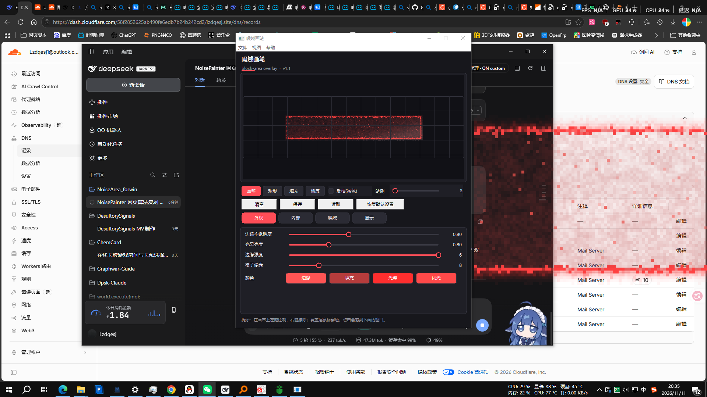
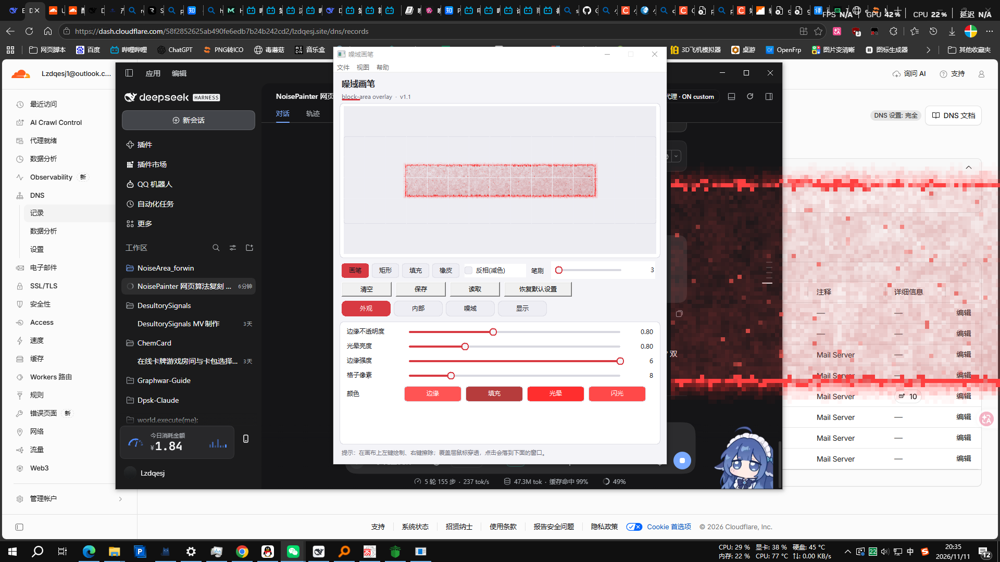

# 噪域画笔 · Noise Area Painter (Windows)

在桌面上盖一层**置顶、鼠标可穿透**的块状噪域覆盖层：控制面板改参数、在预览画布上刷区域，支持双屏与中英双语。

A topmost, **click-through** block-area noise overlay for the Windows desktop. Tune it in the control panel, paint it on the preview canvas; multi-monitor and bilingual (中文 / English).

- C++17 + Win32 + GDI，无第三方依赖 / no third-party deps
- 产物 / build: `build\NoiseArea.exe`（单文件 / single file）
- Windows 10/11 x64





## 功能 / Features

- **编辑噪域**：画笔、矩形、填充、橡皮；可画「减色区」。 / Paint with brush, rect, fill, eraser, plus a dimmed "invert" region.
- **边缘噪声抖动**：遮罩按噪声做 ±45° 双向位移后再采样，边界方块会随时间爬进爬出。 / The mask is displaced by noise (±45°, two-way) before sampling, so the border blocks crawl.
- **四种显示器模式**：仅左屏 / 仅右屏 / 左右同内容 / 左右跨区。 / Four display modes: left, right, mirrored, span.
- **深色 + 浅色主题**，自绘界面。 / Dark and light themes with a fully custom-drawn UI.
- **播放向导**：首次启动先选语言，再看引导。 / First run asks for a language, then walks you through it.
- **配置驱动**：`config.json` 记参数、主题、语言、firstLaunch；`mask.dat` 记遮罩。 / `config.json` holds settings, `mask.dat` holds the painted mask.

## 参数 / Parameters

| 分组 | 中文 | English | 范围 | 默认 |
|---|---|---|---|---|
| 外观 | 边缘不透明度 | Edge opacity | 0–2 | 0.80 |
| 外观 | 光晕亮度 | Glow intensity | 0–3 | 0.80 |
| 外观 | 边缘强度 | Edge strength | 1–6 | 6 |
| 外观 | 格子像素 | Block size | 2–32 | 8 |
| 内部 | 填充强度 | Fill strength | 0–1.5 | 0.667 |
| 内部 | 扭曲强度 | Warp strength | 0–0.5 | 0.15 |
| 内部 | 位移混合 | Warp blend | 0–1 | 0.411 |
| 内部 | 位移速度 | Warp speed | 0–5 | 1.5 |
| 内部 | 闪光色偏 | Spark hue | 0–1 | 0.20 |
| 内部 | 闪光明度 | Spark level | 0–12 | 5.69 |
| 内部 | 扫光速度 | Shine speed | 0–60 | 37.9 |
| 内部 | 扫光亮度 | Shine level | 0–0.5 | 0.12 |
| **噪域** | **噪声强度** | **Noise strength** | 0–2 | 1.0 |
| 噪域 | 噪声半径 | Noise radius | 0.1–1.5 | 0.48 |
| 噪域 | 噪声平滑度 | Noise smooth | 0–2 | 1.0 |
| 噪域 | 噪声演化速度 | Noise evolve | 0–0.2 | 0.03 |
| 噪域 | 方向变化速度 | Direction speed | 0–120 | 60 |
| **噪域** | **边缘抖动** | **Edge jitter** | 0–2 | 0.60 |
| 显示 | 播放速度 | Playback speed | 0–3 | 1.0 |

颜色 / Colors：边缘 Edge `#FF5454`、填充 Fill `#B63C3C`、光晕 Glow `#FF2E2E`、闪光 Spark `#FF4949`。

**噪声强度**驱动「双向噪声置换」：整片遮罩先按低频噪声位移，环带再从位移后的遮罩提取，所以外轮廓会像被整片噪声推着走。0 = 干净方块（完全不抖），调大后边界碎成一颗颗小方块。**边缘抖动**是振幅倍率（1 = 基准 0.1）。
*Noise strength drives the two-way noise displacement: the whole mask is pushed by a low-frequency noise field before the ring bands are extracted, so the outline wobbles as one coherent field. 0 = clean blocks. Edge jitter scales the amplitude (1 = base 0.1).*

## 用法 / Usage

- 画布就是整屏（或所选显示器）缩略图，左键绘制、右键擦除。 / The canvas is a thumbnail of the screen; left-drag paints, right-click erases.
- 标签页：外观 / 内部 / 噪域 / 显示。 / Tabs: Look / Inside / Noise / Display.
- 菜单：文件（保存、读取、清空、恢复默认、退出）、视图（主题、显示器模式、语言）、帮助（播放向导、关于）。
  *Menus: File, View (theme / display mode / language), Help (wizard / about).*
- 面板在覆盖层上是挖空的，不会挡住自己；最小化后噪域铺满整屏。 / The panel is punched out of the overlay.

## 配置文件 / Config

```jsonc
{
  "version": 2,
  "firstLaunch": false,     // true = 下次启动再走一遍向导 / show the wizard next launch
  "theme": "dark",          // dark | light
  "language": "zh",         // zh | en
  "screenMode": "span",     // left | right | same | span
  "enabled": true, "topmost": true, "playing": true,
  "blockPx": 8,
  "noiseStrength": 1.0, "noiseRadius": 0.48, "noiseSmoothness": 1.0,
  "noiseEvoSpeed": 0.03, "noiseDirChange": 60, "edgeJitter": 0.6,
  "edge": "#FF5454", "fill": "#B63C3C", "glow": "#FF2E2E", "spark": "#FF4949"
}
```

- `config.json` 不存在 → 视为首次启动，先选语言，再显示向导，然后写入默认配置。
  *No `config.json` → treat as first run: ask for a language, show the wizard, then write defaults.*
- 「恢复默认设置」= 运行时删除 `config.json` 并立刻补一份默认（`firstLaunch=false`），所以不会重复播放向导。
  *"Reset defaults" deletes `config.json` at runtime and immediately writes a default one, so the wizard does not replay.*

## 编译 / Build

需要 VS2022（MSVC x64）/ requires VS2022:

```bat
build.bat
```

使用 `cl /std:c++17 /O2 /utf-8 /DNOMINMAX /DUNICODE`；源码是 UTF-8（含中文），必须保留 `/utf-8`。
*The sources are UTF-8; keep `/utf-8` or Chinese comments will eat the next line under a GBK code page.*

## 结构 / Layout

```
src\main.cpp      入口 / entry: DPI, config + mask load, message loop
src\control.cpp   控制面板、预览画布、播放向导 / panel, canvas, wizard
src\overlay.cpp   置顶穿透分层窗口（多块）/ layered click-through overlay (multi-target)
src\noise.cpp     噪域合成：位移噪声 / 环带 / 着色 / nearest-neighbour expand
src\app.cpp       config.json、mask.dat、显示器枚举 / config, mask, monitors
src\lang.cpp      中英文案 / bilingual strings
```

## 说明 / Notes

- 噪域是**屏幕空间**的（一「格」= 屏幕像素），不是贴在某张图片上。
  *The area lives in screen space: one cell is a block of screen pixels.*
- 换格子像素或显示器模式时，遮罩按位置/比例重采样，画的区域不会跑位。
  *Changing block size or display mode resamples the mask by position/ratio, so it stays put.*
- 这是独立实现：CPU 合成的 block-area 管线（遮罩 → 环带 → 分层着色），没有参考或使用任何第三方代码。
  *Independent implementation: a CPU block-area pipeline (mask → ring bands → layered shading). No third-party code was used.*

## License

MIT
